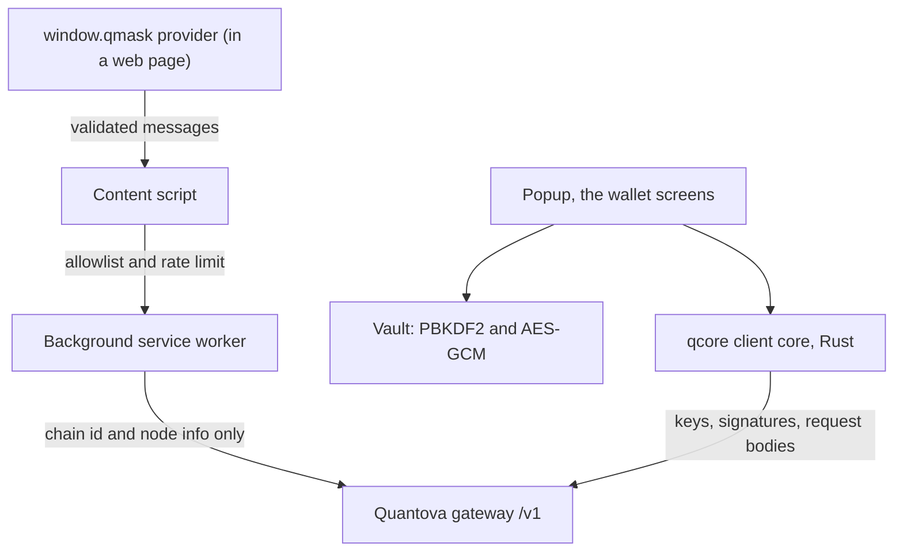
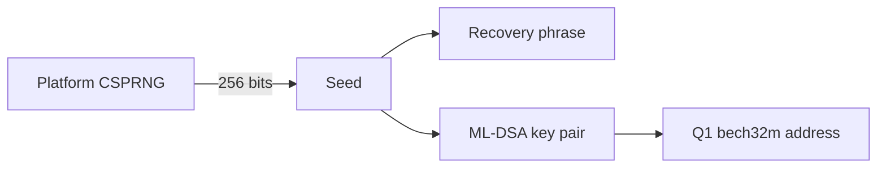
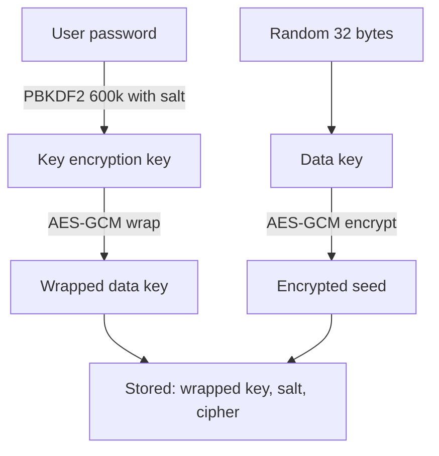

# QMask functionality

QMask is the browser extension wallet for Quantova, a post quantum Layer 1. This repository is a
window into how QMask works. It is for security reviewers and for anyone who wants to see how the
wallet generates keys, stores them, and signs, with the real code that does it. The wallet screens
and the rest of the product are not published here. What is published is the architecture and the
key handling.

The cryptography that derives keys, signs, and builds every request body lives in the Quantova
client core, `@quantovainc/qcore`, which is public. QMask loads that core and adds a thin layer for
entropy, key storage, and the network. This repository documents that layer.

## Architecture

QMask is the shared app rendered on the web with `react-native-web`. It runs in four extension
contexts. The popup is where a person creates or unlocks the wallet and signs. The background
service worker holds the unlock session and relays a small set of read only chain methods. The
content script validates and forwards messages from a page. The injected provider, `window.qmask`,
is a single labelled seam. A page can read chain data through it, and it can ask the wallet to
connect an account or to approve a transfer, and every such request opens the QMask popup for the
person to approve. The provider cannot sign on its own, unlock the wallet, export a key, or add an
account.

No signature and no request body is written in JavaScript. The client core does all of it.



## How a key is generated

A new wallet starts from 256 bits of entropy drawn from the platform cryptographic random source.
If no secure source is present the generator refuses. It never falls back to a weak one.

```ts
// The seed is 256 bits from the platform CSPRNG. There is no weak fallback:
// if a secure random source is missing we throw instead of generating a guessable seed.
export function generateSeed(): string {
  const src = globalThis.crypto;
  if (!src || typeof src.getRandomValues !== 'function') {
    throw new Error('no cryptographic random source is available in this context');
  }
  const bytes = new Uint8Array(32);
  src.getRandomValues(bytes);
  return Array.from(bytes, (b) => b.toString(16).padStart(2, '0')).join('');
}
```

The seed becomes a recovery phrase and a key pair inside the client core. The signature scheme is
post quantum only, ML-DSA-65 by default under FIPS 204, with SLH-DSA under FIPS 205 as the second
scheme. There is no elliptic curve anywhere, no ECDSA, no secp256k1, no Ed25519.

```ts
// The core turns the seed into the recovery phrase and the address.
// The address is a hash of the scheme and the public key, so it is bound to this seed
// and cannot be recreated by anyone who does not hold the seed.
const seed = optionalMnemonic ? seedFromSecret(optionalMnemonic) : generateSeed();
const mnemonic = optionalMnemonic ? optionalMnemonic : mnemonicFromSeed(seed);
const address = coreAddress(seed, ACCOUNT_INDEX);
```



## How a key is stored

The seed is never written in the clear. QMask keeps it under an envelope. The password derives a key
encryption key with PBKDF2 at 600,000 iterations. That key wraps a random data key. The data key
encrypts the seed with AES-256-GCM. Only the ciphertext, the salt, and the wrapped key are stored,
so the password never touches the seed directly and is never kept.

```ts
const PBKDF2_ITERATIONS = 600000;

// The password derives the key that wraps the data key.
// 600k SHA-256 rounds make a stolen vault expensive to brute force.
export const deriveKek = (password, salt, iterations = PBKDF2_ITERATIONS) =>
  pbkdf2Sync(password, salt, iterations, 32, 'sha256');
```

```ts
// AES-256-GCM with a fresh 12 byte nonce and an authentication tag on every record.
// A wrong key or a tampered record fails the tag and decrypts to nothing.
export const encrypt = (text, key) => {
  const iv = randomBytes(12);
  const cipher = createCipheriv('aes-256-gcm', key, iv);
  let out = cipher.update(text, 'utf8', 'hex');
  out += cipher.final('hex');
  const tag = cipher.getAuthTag();
  return { encrypted: out, iv: hex(iv), tag: hex(tag) };
};
```

```ts
// The envelope. A random data key, wrapped by the password key, is what actually encrypts the seed.
const dk = randomBytes(32);                       // the data key
const salt = randomBytes(16);
const kek = await deriveKekAsync(password, salt);  // PBKDF2 600k
const wrappedKey = wrapKey(dk, kek);               // AES-GCM(dk) under the password key
const vault = encrypt(JSON.stringify({ mnemonic, privateKey }), dk);  // AES-GCM(seed) under the data key
// stored: wrappedKey, salt, and vault. The plaintext seed is never persisted.
```

To unlock, the password derives the key encryption key again, unwraps the data key, and the data key
decrypts the seed. A wrong password fails the authentication tag and reveals nothing.



## What is signed

The wallet signs a transfer only after binding it to the network the wallet is set to, and it refuses
a fee higher than the one shown to the user. The gateway's own reported fee is never trusted as the
cap, so an inflated fee from a compromised endpoint cannot be signed.

## Security properties

- Seed entropy is 256 bits from the platform CSPRNG, and the generator fails closed if none is present.
- Keys and addresses are derived by the audited Rust client core, not in JavaScript.
- The signature scheme is post quantum only. No ECDSA, no secp256k1, no Ed25519.
- The seed at rest sits under PBKDF2 at 600,000 iterations and AES-256-GCM, behind a wrapped data key,
  so the password never encrypts the seed directly and is never stored.
- The seed and the private key are never logged, never written in the clear, and never leave the extension.
- The injected page provider can read chain data and can ask the wallet to connect an account or
  approve a transfer, and each request opens the popup for the person to approve. It cannot sign on
  its own, unlock the wallet, export a key, or add an account.
- The content security policy allows no remote scripts and no eval.

## Layout

```
public/               extension manifest, popup shell, assets
src/
  background/         service worker, the unlock session and a read only chain relay
  content/            content script, message validation and forwarding
  inpage/             the window.qmask provider injected into a page
  offscreen/          offscreen document for signing work
shared/src/
  services/
    crypto/           the client core binding, entropy, schemes, signing
    crypto.service    the vault, PBKDF2, AES-GCM, wrap and unwrap
    keychain.service  memory only session storage on the web
  screens/            wallet screens, not published here
  components/         UI, not published here
  store/              app state
```

The full user interface and product code are not in this repository. The snippets above are the
real key handling, shown for review.
